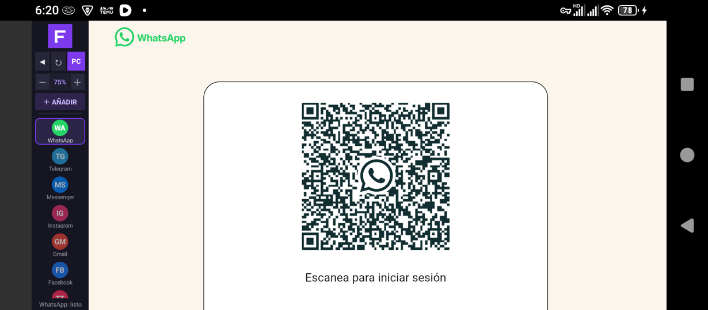
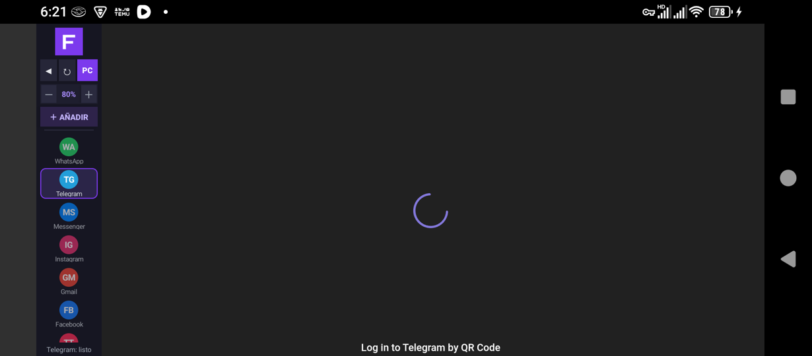
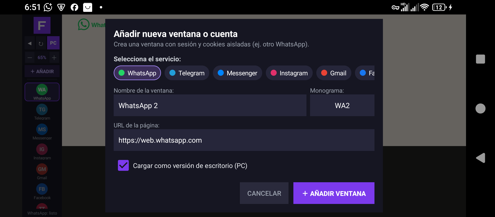
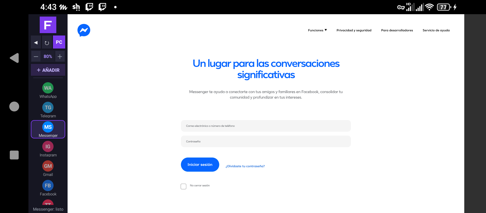

# Ferdium Android (Landscape & Rugged Edition)

Adaptación de Ferdium para dispositivos móviles y rugerizados en orientación horizontal nativa (`sensorLandscape`), optimizada para pantallas ultrapanorámicas y dispositivos como el **Unihertz Tank 2 Pro**.

---

## Características Principales

- **Orientación Horizontal Forzada (`sensorLandscape`)**: La interfaz aprovecha el ancho completo de la pantalla con una barra lateral izquierda de navegación compacta y área de trabajo expandida.
- **Soporte Multi-Cuenta y Sesiones Aisladas**: Permite agregar múltiples instancias de cualquier servicio (por ejemplo, múltiples cuentas de WhatsApp, Telegram o Messenger) con almacenamiento de cookies y sesiones independientes mediante perfiles de WebView.
- **Ajustes de Zoom y Escala Dinámicos**: Controles en barra lateral (+, -, 100%) para ajustar la densidad visual de cada servicio de forma individualizada.
- **WhatsApp Web Optimizado**:
  - Ajuste de breakpoint de escritorio en viewport panorámico.
  - Centrado y renderizado completo del código QR sin recortes.
  - Vigilante automático que evita la expiración y atenuación del código QR durante la vinculación.
- **Compatibilidad de Servicios**:
  - WhatsApp, Telegram, Facebook Messenger, Instagram, TikTok, Gmail, Google Drive, Facebook, X (Twitter).
  - Inyección de User-Agent de escritorio conmutables por pestaña.
- **Compilación Ligera y Autónoma**: Script de construcción `build.sh` que compila el código fuente Kotlin y empaqueta el APK firmado directamente usando Android Build Tools y Kotlin CLI, sin requerir Gradle ni Android Studio completos. Tamaño final inferior a 1 MB (~840 KB).

---

## Capturas de Pantalla

| WhatsApp Web (QR Centrado) | Telegram Web en Horizontal |
| :---: | :---: |
|  |  |

| Cuentas Múltiples (Añadir Ventana) | Facebook Messenger |
| :---: | :---: |
|  |  |

---

## Descarga del APK

Puedes descargar la versión compilada y lista para instalar directamente desde:
- [Carpeta de versiones del repositorio](release/ferdium-landscape-v1.0.0.apk)
- O desde la sección de **Releases** de este repositorio en GitHub.

---

## Compilación desde el Código Fuente

### Requisitos
- Android SDK Build-Tools (versión 34 o superior) con `aapt2`, `d8`, `zipalign` y `apksigner`.
- Android Platform JAR (`android-34`).
- Kotlin Compiler CLI (`kotlinc`).

### Instrucciones
1. Clona el repositorio:
   ```bash
   git clone git@github.com:Spartan117x/ferdium-android-landscape.git
   cd ferdium-android-landscape
   ```
2. Ejecuta el script de compilación:
   ```bash
   ./build.sh
   ```
3. El archivo resultante firmado se generará en la raíz como `ferdium-landscape.apk`.
4. Instala en tu dispositivo mediante ADB:
   ```bash
   adb install -r ferdium-landscape.apk
   ```

---

## Licencia

Distribuido bajo la Licencia Apache 2.0. Consulta el archivo `LICENSE` para más información.
